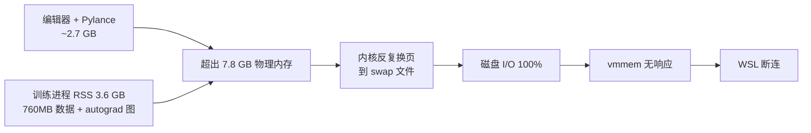

# 资源防护与安全措施（WSL 断连事故结案）

**日期**：2026-10-16
**事故**：WSL 突然断连。用户在任务管理器看到**磁盘 100%**。

---

## 1. 现场取证

```
Mem:  7783 total, 7046 used,  517 free, 546 available   ← 只剩 546 MB
Swap: 2048 total, 1033 used, 1014 free                  ← swap 已吃一半
buff/cache: 218 MB                                       ← 页缓存被榨干
训练进程: VmRSS 3.6 GB, VmSize 5.7 GB, Threads 47
```

**结论：磁盘 100% 不是独立问题，而是"内存不足"的**副产品**。**

WSL2 的 swap 是**磁盘上的文件**（不是独立分区），因果链是：



所以防治的关键是**别让系统进入换页（swap 抖动）**，而不是"限制磁盘"。

---

## 2. 找到的 5 个真实缺陷（全部已修）

| # | 缺陷 | 证据 | 修法 |
|---|------|------|------|
| 1 | `torch.utils.checkpoint` 从未导入 | `import torch; hasattr(torch.utils,'checkpoint')` → **False** | 显式 `import torch.utils.checkpoint` |
| 2 | 进程有 **47 个线程** | `OMP/MKL` 按 `nproc=20` 各开线程；只调 `torch.set_num_threads` **无效** | `install_thread_limits()` 在**库加载前**设 5 个环境变量 + `MALLOC_ARENA_MAX=2` |
| 3 | 数据 760 MB 常驻**匿名内存** | `npz` 不能用 mmap ⇒ 每次访问重读整块（曾致 22.5 GB OOM） | 逐 key 写独立 `.npy` + `mmap_mode='r'` ⇒ 落**页缓存**，内核可回收 |
| 4 | 状态靶子 `E(Xn)` **带梯度前向** | 循环内 `model.encode(...)` 虽随后 `detach()`，但**图已建好** | 一次性在 `torch.no_grad()` 下预计算整段靶子 |
| 5 | 训练前 100 epoch **完全静默** | 唯一打印在 `% eval_every == 0` 处 ⇒ 被杀时无进度无 traceback | 加 `--log-every` 心跳日志 |

### 修复效果（实测）

| 指标 | 修复前 | 修复后 |
|---|---|---|
| 加载数据后 RSS | 1012 MB | **297 MB** |
| 进程线程数 | 47 | **23** |
| 稳态 RSS | ~3200 MB | **2086 MB** |
| 峰值 RSS | 3221 MB | **1702 MB**（bt=1600 配置） |
| 进程 VmSwap | 6560 kB | **0 kB** |
| SWAP 增量 | 有增长 | **0 MB** |

---

## 3. 建立的四层防护

### 3.1 `world/wm_guard.py` —— 进程内护栏（Python 侧）

```python
from wm_guard import install_thread_limits, ResourceGuard, safe_save
install_thread_limits(6)        # ⚠️ 必须在 import numpy/torch 之前
guard = ResourceGuard(tag="wm_sec", workdir=RESULTS)
...
for ep in range(epochs):
    ...                          # 训练
    guard.check()                # 每 epoch 查一次，越界抛 ResourceError
    safe_save(path, payload)     # 节流 + 原子落盘
```

**判据**（连续 2 次越界才动作，避免瞬时尖峰误杀）：

| 判据 | 默认阈值 | 为什么 |
|---|---|---|
| 进程 RSS | 2600 MB 中止 | 本机 7.8 GB，编辑器占 2.7 GB |
| **PSI 内存停顿** | 30% 中止 | **最直接**：被内存等待阻塞的时间占比 |
| **PSI 磁盘停顿** | 50% 中止 | 这就是"**磁盘 100%**"的精确度量 |
| SWAP **增量**（相对启动基线） | 400 MB 中止 | ⚠️ 绝对值不可靠：本机静态就有 1000+ MB |
| 系统可用内存 | < 800 MB 中止 | |
| 磁盘余量 | < 2000 MB 中止 | |

**为什么用 PSI 而不是 swap 字节数**

`/proc/pressure/{memory,io}` 直接给出"有多少时间被阻塞"：

```
# 空闲时
memory: some avg10=0.00 avg60=0.00 avg300=0.00 total=220186849
io:     some avg10=0.00 avg60=0.00 avg300=0.05 total=1242681049
```

事故发生时会冲到几十~100。这比间接的 swap 字节数可靠得多。

**`safe_save` 的两点必要性**
- **节流**（默认 60 s）：磁盘 I/O 本身就是瓶颈，而"最新最优"晚一分钟落盘毫无影响
- **原子**（写 `.tmp` → `os.replace`）：中途被杀不会留下**半个坏文件**
  （旧版直接 `torch.save(path)` 会先截断再写；半个文件会让 `--init` 直接失败，白跑一轮）

### 3.2 `world/run_safe.sh` —— 进程外看门狗（Shell 侧）

```bash
bash world/run_safe.sh logs/job.log python -u world/stage1_sec/wm_sec.py --epochs 100
```

| 层 | 作用 |
|---|---|
| 环境钉死 | `OMP/MKL/OPENBLAS/NUMEXPR/VECLIB` 线程 + `MALLOC_ARENA_MAX=2` |
| **看门狗** | 独立进程每 5 s 采样；用 **SWAP 增量 + PSI** 判断；先 SIGTERM（给机会保存）、20 s 后 SIGKILL |
| 日志轮转 | > 20 MB 切一份，保留最近 10 份 |
| 启动前体检 | 磁盘余量 / 可用内存 / SWAP 不在安全区就拒绝或告警 |

⚠️ **本机没有 cgroup 硬上限可用**（实测结论）：
- WSL 用 `init` 而非 systemd（PID1 = `init`）⇒ `systemd-run` 报
  `System has not been booted with systemd as init system`
- 无免密 sudo，`/sys/fs/cgroup` 对普通用户只读 ⇒ 不能自建 cgroup
- cgroup v2 虽已挂载（`cgroup2 on /sys/fs/cgroup`），但 `memory.max` 不可写
- 退路 `ulimit -v` 限的是**虚拟地址空间**，而 PyTorch 预留大块虚拟内存
  （实测 VmSize 5.7 GB vs RSS 3.6 GB）⇒ 极易误杀，故不用

⇒ 只能靠 **看门狗 + 进程内护栏 + 真正降低内存占用**。

### 3.3 实时原子落盘（防丢结果）

`train()` 每次刷新最优就写 `results/<阶段>/live_<section>_dz<N>.pt`。
旧版只在 `main()` 跑完整个 dz 后才 save ⇒ 中途被杀 = **整轮计算全丢**（实测发生过）。

现在任何时刻 kill 都能拿到当前最好模型，用 `--init live_*.pt` 续训。

**实测验证**：护栏中止时输出

```
⚠️ 资源护栏中止：进程RSS 2729>2600MB。
   → 这是**保护性中止**：继续跑会让 WSL 磁盘 100% 并断连。
   → 已实时落盘的 checkpoint 可用 `--init` 续训。
   ⇒ 最优 checkpoint 已实时落盘：results/.../live_apical_51_dz16.pt
   [护栏汇总] 峰值RSS=2729MB 峰值SWAP=988MB（基线 988） 告警=0 中止=1
```

### 3.4 `world/hygiene.sh` —— 磁盘/内存卫生

```bash
bash world/hygiene.sh          # 只体检（默认）
bash world/hygiene.sh --clean  # 体检 + 清理可再生的中间产物
```

**实测释放 1081 MB**（冗余 npz 726 MB + 老设计缓存 357 MB）。

⚠️ 结果文件（`results/` 下的 `*.pt` 与 `*.json`）**一律不自动删** —— 那是唯一产出。

---

## 4. 内存标定表（h-max=4000，2026-10-16 实测）

`autograd` 图内存 ≈ 正比于「**梯度步数 × 批大小**」= `--step-budget`（当 bt=0 时）

| 配置 | 峰值 RSS | 结论 |
|---|---|---|
| `--step-budget 200000 --bt 0` | 3.6 GB | ❌ 撞 swap 抖动（事故配置） |
| `--step-budget 120000 --bt 0` | 2.9 ~ 3.3 GB | ❌ 看门狗 3200 会触发 |
| `--step-budget 60000 --bt 0` | 2729 MB | ⚠️ 触发护栏 2600 |
| `--step-budget 60000 --bt 1600` | **1702 MB** | ✅ 安全 |
| `--step-budget 60000 --bt 800` | 1788 MB | ✅ 但无进一步收益 |

⇒ **常数项 ≈ 1.6 GB**（torch 运行时 + 23 线程的 arena + 模型），
   图部分靠 `--bt` 钉住最有效。

**长视界的折中（bt > 0 时的实际行为）**

`--bt 1600 --h-max 12000` 并不是"只看 80 ms"：

```
窗口起点 s ─────────────────────────────────────► s+h
           │◄──── no_grad 预热 (h-bt 步) ────►│◄─ BPTT bt 步 ─►│
             模型潜状态被推过完整 rollout        梯度只回溯这一段
             且末步观测有直接监督 (--w-final 1.0)
```

⇒ 模型**见到**完整 600 ms rollout（状态分布被训练覆盖），
   只是这条长路径上的**梯度被截断**（经典 truncated BPTT / stored-state 折中）。
   这是内存与"长视界能否学到"之间必须做的取舍。

**梯度检查点（`torch.utils.checkpoint`）在 CPU 上是净亏**：

| h(步) | 批 | 检查点 | 合计(s) |
|---|---|---|---|
| 4000 | 25 | 关 | **2.69** |
| 4000 | 25 | 开 | 4.76 |
| 16000 | 8 | 关 | **6.86** |
| 16000 | 8 | 开 | 16.44 |

⇒ 默认**关闭**；内存靠 `--bt` 截断来省，而不是靠重算。

---

## 5. 课程学习配置（当前生效）

| 阶段 | h-max | bt | epochs | 说明 |
|---|---|---|---|---|
| 1 | 1600 (80 ms) | 0（全反传） | 1500 | 图小，可全反传 |
| 2 | 4000 (200 ms) | **1600** | 1200 | 梯度段固定 80 ms，预热段走完整 200 ms |
| 3 | 12000 (600 ms) | **1600** | 1000 | 同上，rollout 拉到 600 ms |

公共参数：`--step-budget 60000 --rss-max 2900 --swap-delta-max 400 --avail-min 900`

⚠️ `--rss-max` 的取值逻辑：bt=1600 配置实测稳态 RSS ≈ **2.2 GB**、峰值 ≈ 2.4 GB
⇒ 阈值留到 2900 MB。**真正的安全阀是 `--avail-min 900` + 看门狗的 SWAP 增量/PSI** ——
机器还有 2.8 GB 可用时，完全不需要因 RSS 中止（RSS 只是代理指标，PSI 才是真相）。

⚠️ 预热段 `no_grad` ⇒ 梯度只回溯 1600 步，但**模型的潜状态仍会被推过整个
h 步 rollout**，且末步观测有直接监督（`--w-final 1.0`）⇒ 长视界仍被训练，
只是这条长路径上的梯度被截断（经典的 truncated BPTT / stored-state 折中）。

---

## 6. 日常使用清单

**跑任何长任务前**：

```bash
bash world/hygiene.sh              # ① 看磁盘/内存余量
bash world/run_safe.sh logs/x.log <命令>   # ② 用安全启动器（别裸跑 python）
```

**训练脚本里**：`install_thread_limits(N)` 在 import numpy 之前；
循环里每 epoch `guard.check()`；落盘一律 `safe_save()`。

**WSL 侧（可选，需管理员权限）**：在 Windows 用户目录建 `.wslconfig`
可以给 WSL 更小的内存/swap，让"超限"更早暴露而不是拖垮系统：

```ini
[wsl2]
memory=8GB
swap=2GB
```

⚠️ 但**变小不会解决根因**，只会更早触发护栏。真正的解法是上面的四条。

---

## 7. 教训

1. **"磁盘 100%" 往往不是磁盘问题** —— 先查 `free -m` 与 `/proc/pressure/io`。
   WSL2 的 swap 在磁盘上 ⇒ 内存不足会直接表现为磁盘饱和。
2. **`torch.set_num_threads()` 只管 torch** —— OMP/MKL/OpenBLAS 各自的线程数要在
   **库加载前**用环境变量设。线程数直接决定 glibc arena 数量与碎片化程度。
3. **`.npz` 不能 mmap，单个 `.npy` 可以** —— 这个区别在内存吃紧时是"能跑"与
   "把系统拖垮"的分界。只读的原始数据应该走 mmap 落页缓存（可回收），
   而不是常驻匿名内存。
4. **`detach()` 不会释放已建的图** —— 要在 `no_grad()` 下**前向**才算省内存。
5. **资源阈值要用"相对基线"** —— 本机静态 SWAP 就有 1000+ MB；
   用绝对值会让护栏在看门狗启动的**第 0 秒**就误杀（实测踩过两次）。
6. **PSI 比任何自造的启发式都好用** —— `memory`/`io` 的 `avg10` 直接就是
   "被阻塞的时间百分比"。
7. **长任务必须有心跳日志 + 实时落盘** —— 否则被杀时既不知道跑到哪，
   也拿不回任何结果（两次事故的共同教训）。
8. **`torch.utils.checkpoint` 必须显式导入** —— `import torch` 不暴露子模块。
