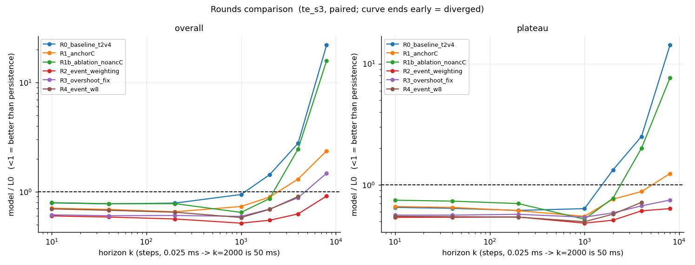

# 试验轮次索引

> 由 `python -m tools.rounds_index` 自动生成。
> 每轮一个子目录：`README.md` / `metrics.json` / `figures/` / `logs/` / `ckpt/`。

## 总览

| 轮次 | 说明 | σ | cos(k=2000) 中位 | V上限 | cai P | cai R | 峰F1 | 幅度比 | k=10 | k=40 | k=200 | k=1000 | k=2000 | k=4000 | k=8000 | a(200) |
|---|---|---|---|---|---|---|---|---|---|---|---|---|---|---|---|---|
| `R0_baseline_t2v4` | v4 基线（无 ③b，batch 32） | 0.000362 | +0.207 | 56.0 | 0.217 | 0.912 | 0.000 | nan | 0.788 | 0.773 | 0.786 | 0.942 | 1.429 | 2.773 | 22.025 | **0.786** |
| `R1_anchorC` | ③b 闭环段 latent 自洽（anchor-cl 0.1，batch 24） | 0.000301 | +0.859 | 12.7 | 0.337 | 1.000 | 0.162 | 0.63 | 0.706 | 0.686 | 0.654 | 0.732 | 0.892 | 1.304 | 2.368 | **0.654** |
| `R1b_ablation_noancC` | 消融：关掉 ③b（anchor-cl 0，其余同 R1） | 0.000351 | +0.174 | 2.2 | 0.959 | 0.251 | 0.000 | nan | 0.793 | 0.776 | 0.777 | 0.646 | 0.865 | 2.458 | 15.824 | **0.777** |
| `R2_event_weighting` | ①②③b 事件加权 + 档加权采样 + 分层采样 | 0.000310 | +0.961 | 19.7 | 0.696 | 0.867 | 0.294 | 0.84 | 0.600 | 0.585 | 0.562 | 0.515 | 0.547 | 0.625 | 0.911 | **0.562** |
| `R3_overshoot_fix` | R2 基础上 event-weight 10→5 + anchor-cl 0.1→0.2 | 0.000316 | +0.869 | 10.8 | 0.155 | 0.273 | 0.250 | 1.04 | 0.614 | 0.602 | 0.605 | 0.593 | 0.692 | 0.880 | 1.473 | **0.605** |
| `R4_event_w8` | 回归 R2 配置，仅 event-weight 10→8 | 0.000346 | +0.924 | 14.3 | 0.940 | 0.170 | 0.324 | 1.23 | 0.695 | 0.675 | 0.648 | 0.579 | 0.688 | 0.901 | **DIV** | **0.648** |

## 各轮详情

- [`R0_baseline_t2v4`](./R0_baseline_t2v4/README.md) — v4 基线（无 ③b，batch 32）
- [`R1_anchorC`](./R1_anchorC/README.md) — ③b 闭环段 latent 自洽（anchor-cl 0.1，batch 24）
- [`R1b_ablation_noancC`](./R1b_ablation_noancC/README.md) — 消融：关掉 ③b（anchor-cl 0，其余同 R1）
- [`R2_event_weighting`](./R2_event_weighting/README.md) — ①②③b 事件加权 + 档加权采样 + 分层采样
- [`R3_overshoot_fix`](./R3_overshoot_fix/README.md) — R2 基础上 event-weight 10→5 + anchor-cl 0.1→0.2
- [`R4_event_w8`](./R4_event_w8/README.md) — 回归 R2 配置，仅 event-weight 10→8
