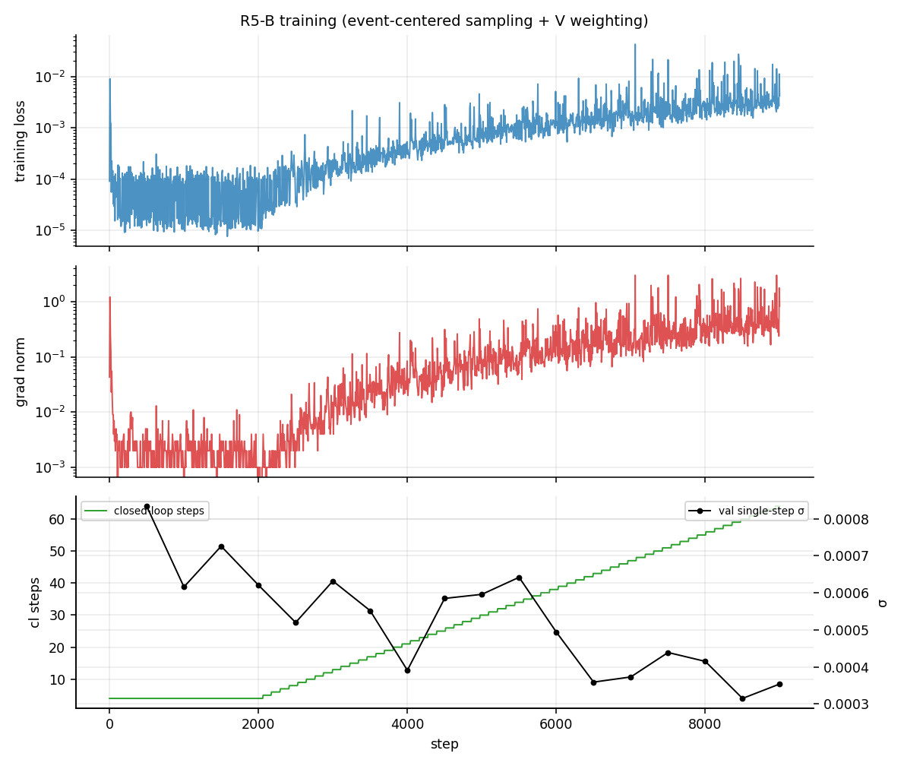
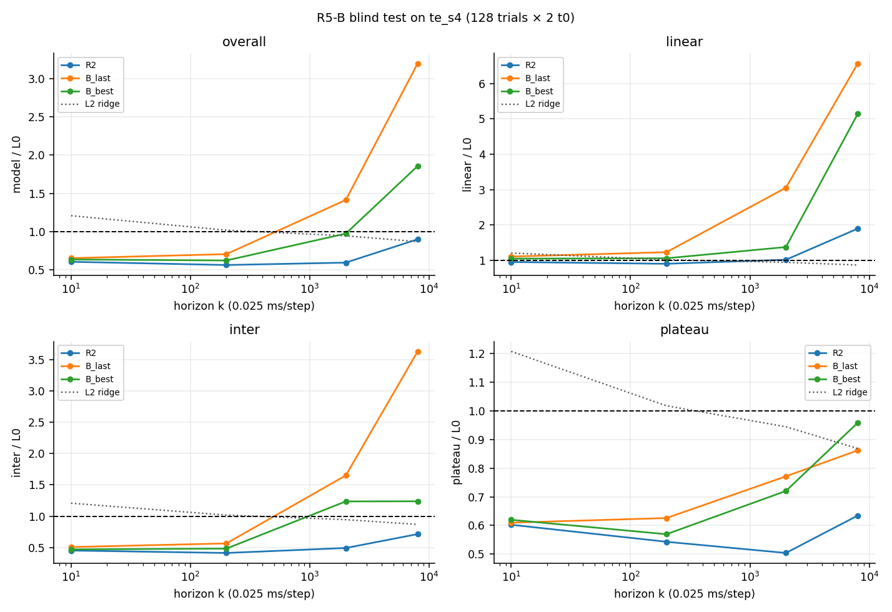
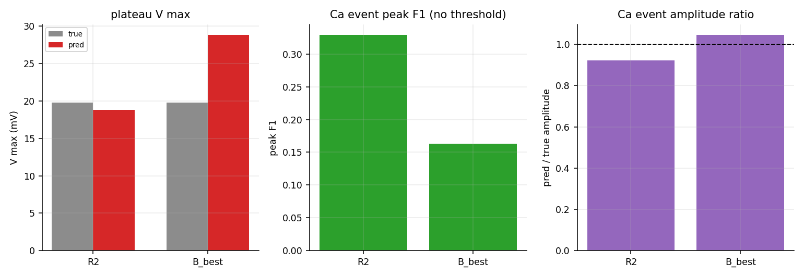
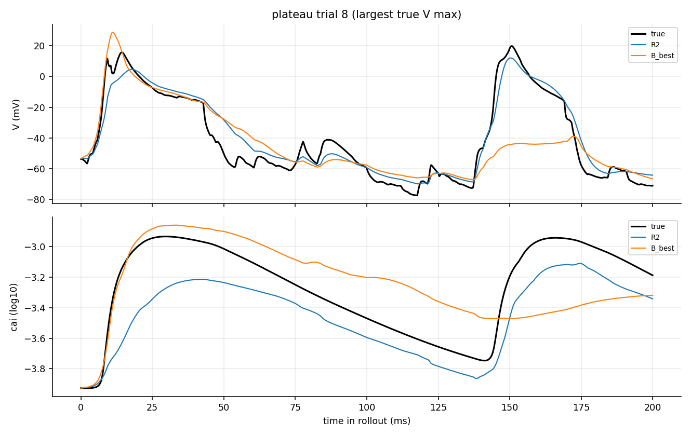

# R5-B：事件中心采样 + V 事件加权

> run: `runs/2026-10-27-d2a3c49-r5b`  ·  data: `te_s4`  ·  ckpt: `r5b_event_center/best.pt`
> 自动生成；数值来自 `stdout.log` / `eval_te_s4.json` / 本次 plateau rollout。

## 1. 这次改了什么

- 保留 R2 的训练视界（length=128 = 3.2 ms，cl=64 = 1.6 ms）和 9000 步预算；
- **50% 窗口以 Ca episode 中心开窗**（其余随机）；
- 在原有 cai 事件加权上，增加 **V 事件加权**（weight=5, tau=0.02）；
- 其余与 R2 相同：d_z=16、anchor-cl=0.1、event-weight=10、batch=24。

## 2. 训练

- 最终 loss = 4.192e-03，grad = 0.833，cl = 64
- 最后单步 σ = 0.000354

## 3. te_s4 盲测

| k | R2 | B_last | B_best |
|---|---|---|---|
| 10 | 0.605 | 0.652 | 0.635 |
| 200 | 0.562 | 0.705 | 0.622 |
| 2000 | 0.594 | 1.414 | 0.973 |
| 8000 | 0.899 | 3.199 | 1.858 |

## 4. 物理指标（plateau, k=8000, t0=4000）

| model | Vmax pred | Vmax true | Ca peak F1 | amp ratio |
|---|---:|---:|---:|---:|
| R2 | 18.85 | 19.81 | 0.329 | 0.923 |
| B_best | 28.82 | 19.81 | 0.163 | 1.045 |

## 5. 一个 plateau trial 的轨迹

## 6. 结论

- 盲测 k=8000：R2 = 0.899，B_best = 1.858；
- 盲测 k=2000：R2 = 0.594，B_best = 0.973；
- 判定：**B 没有改善**；R2 仍是当前最优。
- B 的短/中程也变差，且 B_last 在 8000 步时 28/256 个样本发散；
  事件中心采样把窗口压到 Ca episode 上，但 128 步仍只有 3.2 ms，
  可能造成事件片段过拟合，而没有改善慢态/长程。
